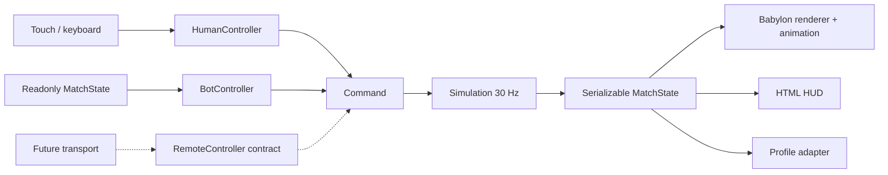

# Архитектура

## Слои

| Каталог                           | Ответственность                                                   |
| --------------------------------- | ----------------------------------------------------------------- |
| `src/app`                         | Жизненный цикл, экраны, подключение контроллеров, dev-инструменты |
| `src/game/core`                   | Сериализуемые типы, математика, фиксированный шаг                 |
| `src/game/simulation`             | Движение, коллизии, бой, статусы, снаряды, зоны, волны и босс     |
| `src/game/classes`                | 15 классов, пассивные свойства и 60 деклараций навыков            |
| `src/game/ai`                     | BotController, задержка реакции и навигация по сетке              |
| `src/game/teams`                  | Слоты и проверка ограничения 3 героя                              |
| `src/game/maps`                   | Геометрия коллизий и расположение целей трёх карт                 |
| `src/game/modes`                  | Захват, счёт, таймер, респауны, условия завершения                |
| `src/game/controls`               | HumanController, pointer capture, multitouch, клавиатура          |
| `src/game/rendering`, `animation` | Babylon, GLB, инстансинг, скелетные анимации, эффекты, звук       |
| `src/game/inventory`, `storage`   | Предметы, локальный профиль и идемпотентные награды               |
| `src/game/networking/interfaces`  | Контракты Controller, RemoteController, MatchTransport            |
| `src/telegram`                    | Проверки возможностей Telegram SDK и событий видимости            |
| `src/ui`                          | HTML/CSS, HUD и оригинальные SVG-иконки                           |

Симуляция не импортирует Babylon.js, DOM, Telegram, время устройства или localStorage. `Simulation.step(commands)` принимает строго 1/30 секунды. Случайные идентификаторы матча создаёт приложение до начала симуляции. Источник случайности для лута — seeded PRNG. Состояние, счётчики идентификаторов, снаряды, зоны, статусы и таймеры сериализуются.

Боевой код один для людей и ботов. Контроллеры задают движение, атаку, навык и цель; HumanController не изменяет здоровье. Принимается не больше одной команды от актора за шаг. Система команд пока доверенная локальная; она **не** является защитой от читов.

Для ИИ отделён выбор цели от исполнения удара. Дальние атаки проверяют прямую видимость, снаряды — непрерывное пересечение отрезка со стеной. Движение скользит вдоль стен, уклонение разбито на подшаги. Для ботов используется ограниченный A* по сетке с проверкой диагоналей. Прикрытие реализовано геометрией и выбором дистанции, без сложной системы тактических укрытий.

## Перенос на Node.js

1. Перенести `core`, `simulation`, `classes`, `maps`, `modes`, `teams` и `ai` в общий workspace-пакет. Их уже можно выполнять в Node (так выполняются unit-тесты).
2. На сервере владеть MatchState и фиксированным тиком; сервер назначает слот, seed, состав и нормализованные характеристики.
3. Реализовать RemoteController/MatchTransport: номера команд, допустимое окно тиков, подтверждения, проверку владельца слота и лимит частоты. Запретить клиенту задавать `actorId` чужого участника.
4. Передавать снимки состояния и события с подтверждённой последовательностью; в рендерере добавить буфер интерполяции, предсказание перемещения и reconciliation.
5. Разрешать замену BOT на HUMAN_REMOTE до боя или между матчами. `replaceController` отклоняет замену в идущем матче. Hot join отдельно не реализован.
6. Вынести профиль, лут и награды в серверное хранилище с идемпотентностью по Match ID. Проверять Telegram initData только на сервере. Не доверять локальному профилю.

Сейчас сетевой транспорт существует только как контракт. Переподключение, matchmaking и серверная авторизация не имитируются локальными заглушками.

## Ресурсы и производительность

GLB загружаются лениво и кешируются внутри сцены. Статические модели создаются экземплярами общей геометрии. Скрипт обработки ассетов удаляет неиспользуемые анимации, упрощает ключи с допуском и объединяет дублирующиеся данные. Текстуры используют атласы исходных KayKit-паков. Для низкополигональных моделей отдельный LOD пока не нужен; его следует добавить при замене на более тяжёлые ассеты.

Low отключает тени и glow и снижает разрешение. Medium использует тени 1024, High — 2048. При низком измеренном FPS разрешение дополнительно уменьшается в ограниченных пределах. Эффекты имеют ограничение количества и удаляются после завершения. При смене матча освобождаются экземпляры, анимационные группы и личные материалы, а общий кеш ассетов сохраняется. На непрозрачных экранах инвентаря и героев основной мир не рендерится; 3D-превью героя использует отдельную сцену, которая уничтожается при выходе.
